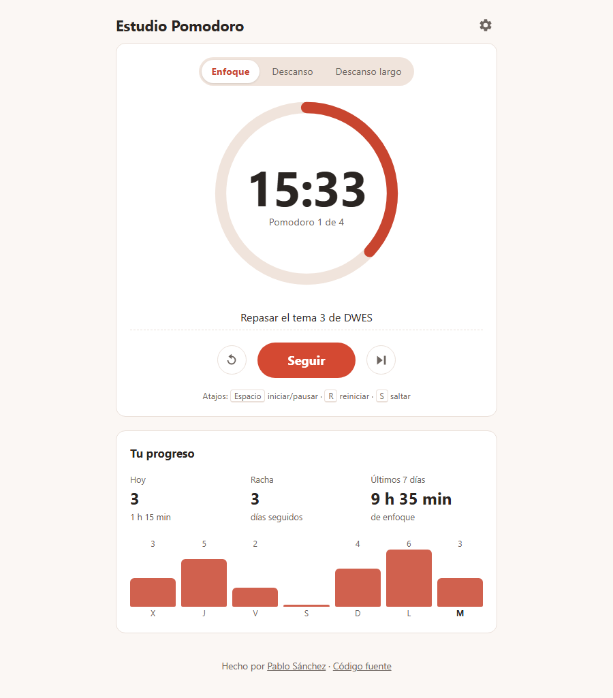
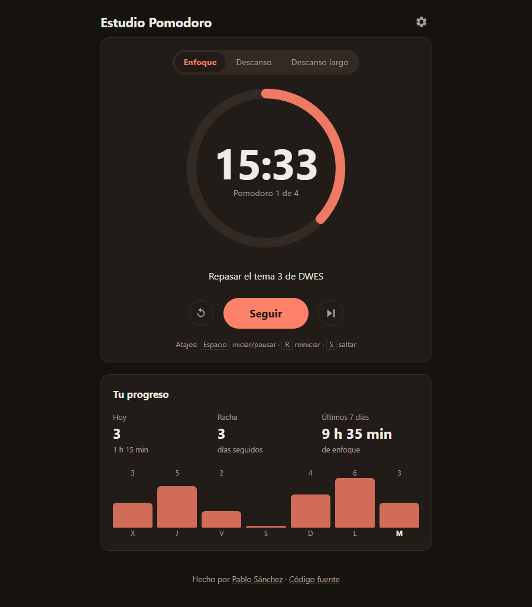
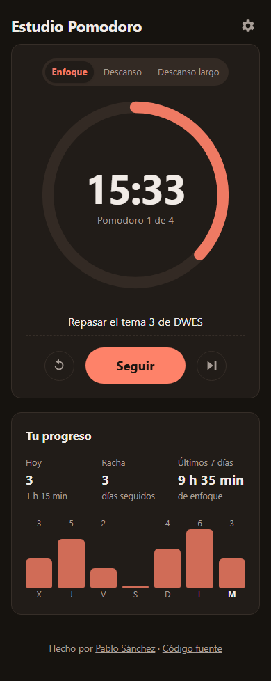
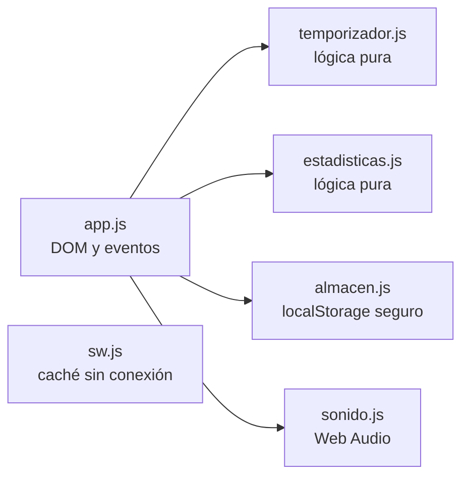

# Estudio Pomodoro

[](https://github.com/pablosanchezcontento-afk/estudio-pomodoro/actions/workflows/ci.yml)


Temporizador **Pomodoro** para estudiar: 25 minutos de concentración, descansos
cortos y uno largo cada cuatro. Se instala como una aplicación, **funciona sin
conexión** y guarda tus **estadísticas** de estudio.

🍅 **Úsalo ya:** <https://pablosanchezcontento-afk.github.io/estudio-pomodoro/>

| Modo claro | Modo oscuro | Móvil |
|---|---|---|
|  |  |  |

## Funcionalidades

- ⏱️ Ciclo Pomodoro completo: enfoque, descanso corto y descanso largo tras N pomodoros.
- ⚙️ Duraciones configurables y opción de encadenar las fases automáticamente.
- 📊 Estadísticas: pomodoros y minutos de hoy, racha de días seguidos y gráfica de la última semana.
- 🔔 Aviso sonoro (generado con Web Audio, sin archivos) y notificación del sistema si estás en otra pestaña.
- 📝 Campo "¿En qué vas a trabajar?" que se recuerda.
- ⌨️ Atajos de teclado: <kbd>Espacio</kbd> iniciar/pausar, <kbd>R</kbd> reiniciar, <kbd>S</kbd> saltar fase.
- 📴 Funciona sin conexión gracias a un *service worker*, y se puede instalar en el escritorio o el móvil.
- 🌗 Modo oscuro automático, diseño adaptable y accesible (lectores de pantalla, foco visible, movimiento reducido).
- 🔒 Todo se guarda en tu navegador (`localStorage`): sin cuentas ni servidores.

## Cómo está hecho



| Archivo | Responsabilidad |
|---|---|
| `js/temporizador.js` | Estado inmutable del temporizador: iniciar, pausar, avanzar de fase, formatear. |
| `js/estadisticas.js` | Historial por día, racha, últimos 7 días. |
| `js/app.js` | Conecta la lógica con la interfaz, las notificaciones y el sonido. |
| `js/almacen.js` | Lee y escribe en `localStorage` sin fallar en modo privado. |
| `sw.js` | Guarda la aplicación en caché para usarla sin conexión. |

Decisiones técnicas:

- **El tiempo se calcula con marcas de tiempo**, no contando segundos. Los
  navegadores ralentizan los temporizadores de las pestañas en segundo plano;
  guardando el instante de fin, la cuenta atrás es exacta aunque cambies de
  pestaña, y sigue correcta si recargas o cierras la página.
- **La lógica no toca el DOM.** `temporizador.js` y `estadisticas.js` son
  funciones puras que devuelven un estado nuevo, lo que permite probarlas al
  100 % sin navegador.
- **Sin frameworks ni dependencias en producción**: HTML, CSS y JavaScript
  con módulos ES. Node solo se usa para los tests.

## Ejecutar en local

Los *service workers* y los módulos necesitan un servidor (no basta con abrir el archivo):

```bash
npm run servir          # http://127.0.0.1:4173 (servidor estático incluido, sin dependencias)
# o bien
python -m http.server 4173
```

## Tests

```bash
npm install
npm test                # 57 tests unitarios con Vitest
npm run cobertura       # exige 100 % de líneas y funciones en la lógica, el almacén y el sonido
npm run e2e             # 20 pruebas en Chromium (escritorio y móvil) con Playwright
npm run lint            # ESLint
npm run validar         # valida el HTML con html-validate
npm run comprobar       # todo lo anterior
```

Las pruebas en navegador usan un reloj simulado para completar un pomodoro entero en milisegundos y
comprueban: iniciar/pausar/seguir, atajos de teclado (y que no se disparan al escribir), paso al descanso y
registro en estadísticas, ajustes que sobreviven a una recarga, un temporizador en marcha que continúa tras
recargar, **funcionamiento sin conexión** con el *service worker* y **accesibilidad** con axe (WCAG 2.1 AA).
Un test unitario verifica además que el *service worker* guarda en caché todos los archivos que usa la página.

La integración continua ejecuta lint, tests, validación y pruebas en navegador en cada *push* y, si todo
pasa, publica la web en GitHub Pages.

## Autor

**Pablo Sánchez Contento** · [GitHub](https://github.com/pablosanchezcontento-afk)
